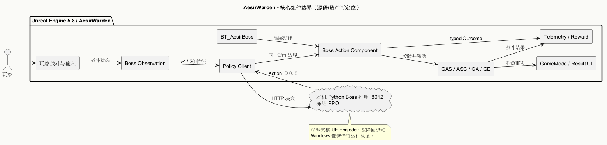

# 技术架构

> 状态：当前源码结构核对 + 未验收的目标链路 · 2026-09-29

## 运行边界

`玩家输入/战斗 → UE 战局状态 → Boss Observation → BT 或 PPO 高层 Action → 共享 Boss Action Component → GAS Ability/Effect → 动画/命中/伤害 → Telemetry → 下一次 Observation`。

交互预览：[Boss共享执行时序（历史技术参考）](../../UML/Technical/06_BossDecisionSequence.png)。当前需求故障语义见[Boss回退分析时序](../../UML/png/09_BossFallbackSequence.drawio.png)，对象职责见[课程对象分析](../../09_Course_Analysis/01_RetryObjectAnalysis.md)。

UE 负责目标、状态、能力合法性与伤害结算。Python Boss 服务返回高层动作建议，同伴服务负责聊天与命令建议；实际战斗都由 UE 执行。依赖见 [Build.cs](../../../Source/AesirWarden/AesirWarden.Build.cs)，连接配置见[工程速查](../../05_Development_Guide/01_ProjectQuickReference.md)，协议和动作见[Boss RL 契约](../../08_RL_Research/01_BossRLContract.md)。

## 模块职责

| 部分 | 当前代码/资产 | 责任 |
| --- | --- | --- |
| 玩家与战斗 | `Characters/Player`、`Combat`、`Abilities` | 输入、锁定、受击、运行时属性与能力 |
| Boss 决策 | `AI/Boss`、`Content/Aesir/AI/Boss` | Observation、BT/PPO 请求、回退、动作结果 |
| 共享执行 | `UAesirBossActionComponent`、GAS Ability/Effect | 统一合法性判断与实际能力激活 |
| 战局与呈现 | `Framework`、`Content/Aesir/UI` | 胜负事件、HUD/结果 Widget |
| 同伴服务 | `Services/Companion`、`AI/Companion` | 聊天/命令接入和订单校验；实际战斗执行与回执按 M5 接通 |

## 设计约束

- Observation、Action 的版本、顺序和值由 [RL 契约](../../08_RL_Research/01_BossRLContract.md)维护；修改时同步两端并检查模型是否需要重训。
- BT 与 PPO 共享 GAS 执行、能力配置、遭遇规则和遥测口径；模拟器 `RuleBossPolicy` 不能当 UE BT。
- 一次服务错误、连续失败、超时、错误 Schema 与非法动作必须可区分记录；当前回退代码仍有待修复问题，见[KnownIssues](../../06_Test_Doc/02_KnownIssues.md)。
- 图预览集中在 [UML](../../UML/)，正文保存职责与边界；工程和实验的当前状态以实际验证记录为准。
